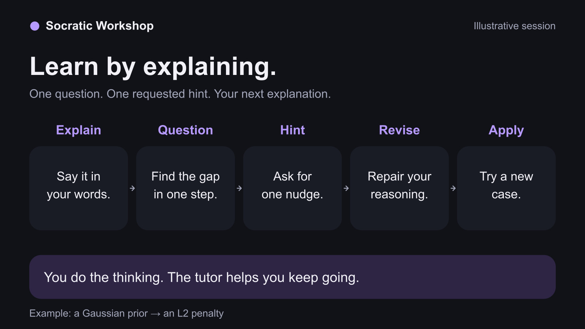
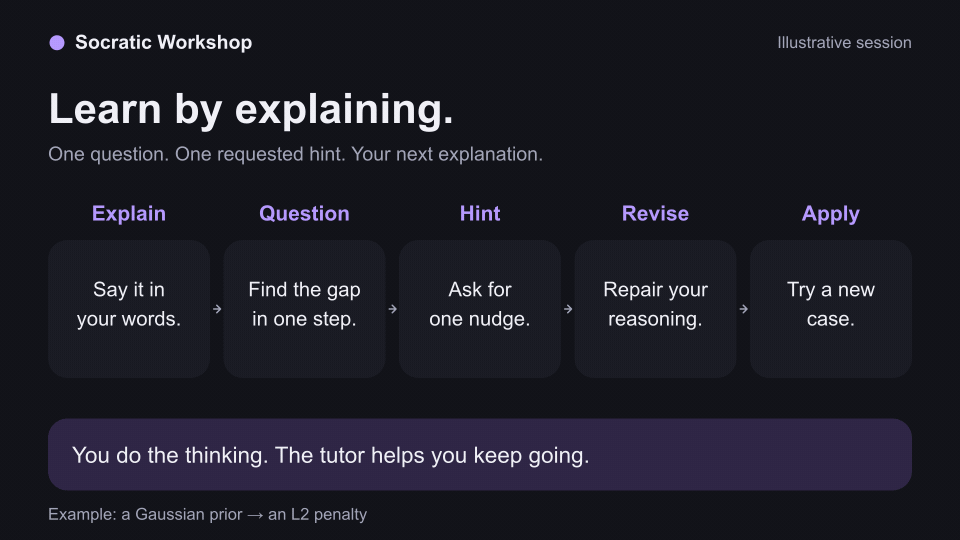
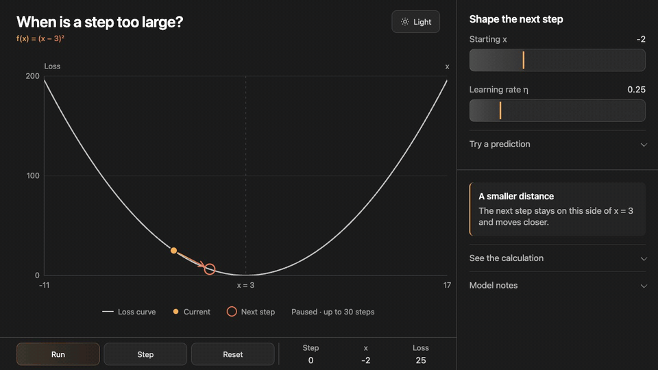
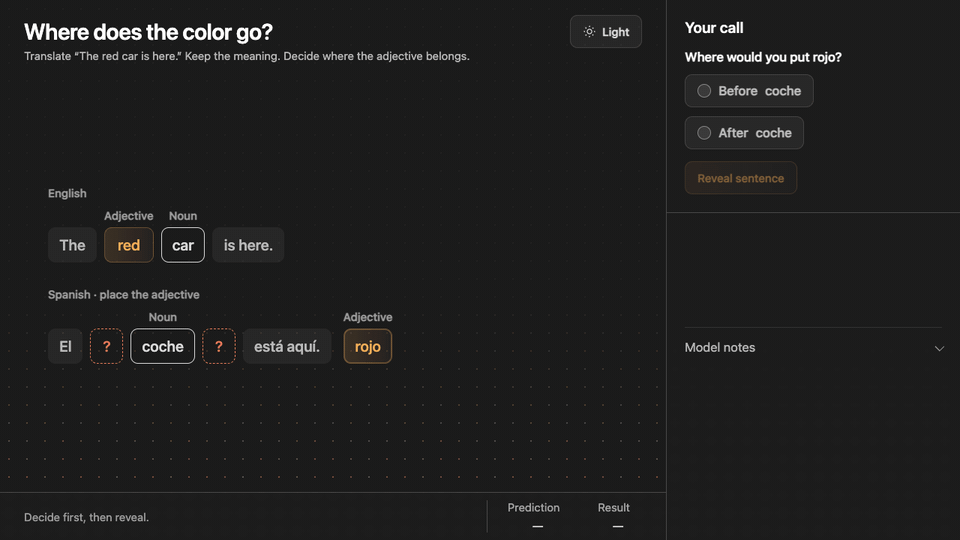
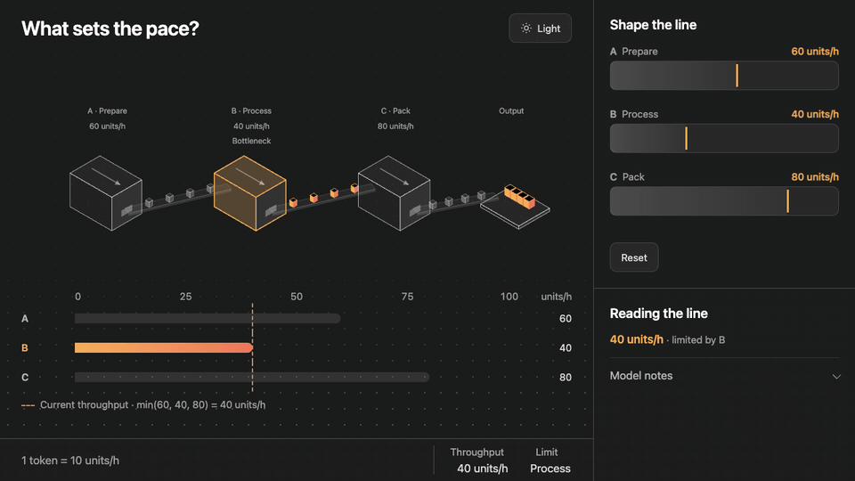
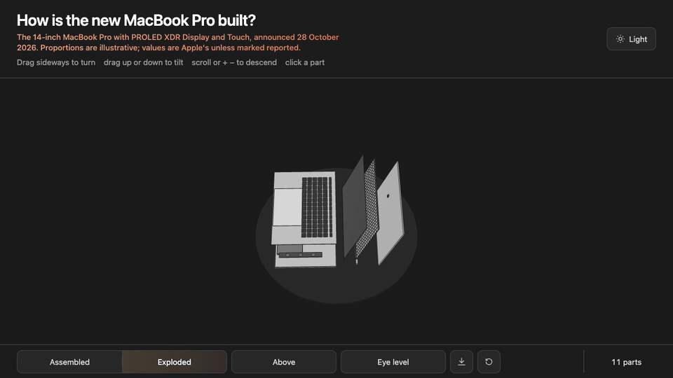

# Socratic Workshop

By [Noa Katana](https://noakatana.com/work/socratic-workshop/), creative technologist in Munich.

Learn an idea by explaining it to your AI tutor. It works for any subject: math and machine learning, a new language, or an unfamiliar codebase.

The tutor splits your topic into 4 to 10 subskills, places you on each with a short diagnostic, then asks one question at a time. You earn levels by explaining, predicting and applying, and a skill map in the chat shows where you stand. Bring your own book, course, paper, or codebase.

When a picture helps, the tutor builds a compact interactive HTML figure, or you ask for one. Explore it, commit to a prediction, and explain what changed.

Directly inspired by **Miles Cranmer's [How to Avoid AI Brain Rot](https://www.youtube.com/watch?v=uXC7OuCas2Q&t=1438)**, especially 23:58–34:33. The session structure follows **Jane Street's [socratic-tutor](https://github.com/janestreet/agent_skills/tree/master/socratic-tutor)**. The visual approach uses my Workbench adapter, inspired by **[Anatomy](https://github.com/wheresryan22/anatomy)**.

## Start a session

Install with the [skills CLI](https://github.com/vercel-labs/skills), then choose your agent:

```sh
npx skills add smashburger-dev/socratic-workshop
```

Add `-g` to install for your user instead of one project.

| Agent | Start learning |
| --- | --- |
| [Claude Code](https://code.claude.com/docs/en/skills) | `/socratic-workshop Teach me L2 regularization. Let me explain first.` |
| [Codex](https://developers.openai.com/codex/skills/) | `$socratic-workshop Teach me L2 regularization. Let me explain first.` |

Claude Code uses `/skill-name`. Codex uses a `$skill-name` mention or its `/skills` picker. You can also ask your agent to use the skill in plain language. A one-off "explain X" gets a normal answer; the session starts when you ask to be taught.

## The learning loop



Explain what you understand. Work through one question or requested hint. Revise your explanation, then apply the idea to a small new case. The tutor varies its questions: predict an outcome, explain a step, find the flaw in a wrong claim, transfer the idea to another domain, connect two subskills. When you are right it sometimes argues the opposite, and you defend your answer.



An illustrative conversation about a Gaussian prior and L2 regularization, rendered for this demo. It is not a recording of a real learner.

## The skill map

After the diagnostic, and after every level change, the tutor renders your progress in the chat:

```text
Topic: L2 regularization                       overall █████░░░░░ 50%
─────────────────────────────────────────────────────────────────────
penalty term in the loss      [████████░░] 4/5  ✓ target
effect on the weights         [██████░░░░] 3/5  ← focus
Gaussian prior link           [██░░░░░░░░] 1/5
choosing lambda               [████░░░░░░] 2/5  ▼ review
─────────────────────────────────────────────────────────────────────
```

| Level | You |
| --- | --- |
| 0 | have not met the idea |
| 1 | recognize it |
| 2 | follow an explanation |
| 3 | explain or solve it with hints |
| 4 | explain and apply it unaided |
| 5 | transfer it, handle edge cases, could teach it |

Levels are earned. Level 4 takes two correct answers on different questions without a hint, one of them recalled after other work, plus one transfer and one connection to another subskill. The tutor re-tests earlier subskills without warning, and a miss lowers the level. The session ends with a final assessment: one question per subskill, one problem that combines them, and one in a domain you have not seen.

Say any of these at any time, in your own language:

| Command | Effect |
| --- | --- |
| show progress | renders the skill map |
| harder / easier | shifts the next questions one level |
| hint | one small hint, then you try again |
| just tell me | a direct explanation of the current step |
| show me | builds a figure for the current gap |
| skip | moves to the next subskill |
| save state / resume from: | a compact block to continue in a new session |

## Visual learning

Each figure has one job, picked from your level on the subskill:

| Job | You |
| --- | --- |
| orient | name the parts and say what each is for |
| predict | commit to an outcome before the figure shows it |
| probe | find the input where the behaviour changes |
| transfer | map the same mechanism onto a second domain |
| break | find the planted flaw |

The tutor builds one without being asked when the same gap survives two attempts in words, or when you miss a question on a subskill about structure, a process, or quantities that interact. What you saw in the figure goes back into your own explanation, and that explanation is what counts.

### Gradient descent



[HTML file](examples/gradient-descent.html)

### Spanish word order



[HTML file](examples/spanish-word-order.html)

### Process bottlenecks



[HTML file](examples/bottleneck.html)

### How is it built? Exploded views

Ask how something is assembled, and the tutor can build an exploded view:

```text
/socratic-workshop How is the new MacBook Pro built? Show me the parts, then let me explain why its screen can sense touch.
```



Scroll to descend from a bird's-eye view to eye level, drag to turn and tilt, and click a part to read its job and its real specifications. Up and Down walk the parts in assembly order. With Recall on (try it in the [key switch](examples/keyboard-switch.html)), a part shows only its number until you have said what it is for. When you stop, the object keeps turning slowly from wherever you left it. Parts can separate vertically, horizontally, radially, or each in its own direction. Export saves the current view as a print-ready PNG or SVG with part labels.

[MacBook Pro](examples/macbook-pro.html) · [Key switch](examples/keyboard-switch.html) (vertical) · [Limo door](examples/limo-door.html) · [Flashlight](examples/flashlight.html) · [Studio Display XDR](examples/studio-display-xdr.html) (horizontal)

These GIFs are rendered previews of the example models. The illustrative prompt above was written for this demo.

Download an HTML file and open it in a browser. Each is standalone, with light/dark themes and no build step. GitHub's file view shows the source.

The same [visual templates](assets/visualization-shell.html) are available to the skill. A hint view reveals only the current hint; a full explanation can support direct exploration. Desktop examples are composed for a single visible frame.

Study material stays outside the tutoring chat. In a codebase, the tutor offers a worktree, a branch, or read-only study before creating learning files. It creates no automated tests for those artifacts.

## Make it yours

Use this skill as a starting point. Adjust the visual style, change how hints work, or extend the learning loop to suit how you learn. Edit [SKILL.md](SKILL.md) and the [visual guidelines](references/workbench.md), or ask your agent to help.

## Credits

- [Miles Cranmer's talk](https://www.youtube.com/watch?v=uXC7OuCas2Q&t=1438), shared by MPhil in Data Intensive Science Cambridge, inspired the learning workflow.
- Jane Street's [socratic-tutor](https://github.com/janestreet/agent_skills/tree/master/socratic-tutor) skill (MIT) gave the session its structure: subskills, the diagnostic, the level scale and its ASCII map, devil's advocate, strict evidence, spaced review, the final assessment and the commands.
- [Anatomy](https://github.com/wheresryan22/anatomy) inspired the visual approach and the exploded views, adapted from my Werkbankfiguren work in [Argmin](https://github.com/smashburger-dev/argmin). The exploded views and their PNG/SVG export are inspired by Jakub Krehel's [/teardown skill](https://github.com/jakubkrehel/skills/tree/main/skills/teardown); the kit here is an independent implementation.
- The frosted-glass visual language comes from my chiasma design system, with material and legibility guidance from Apple's [Human Interface Guidelines](https://developer.apple.com/design/human-interface-guidelines/materials).
- [Source notes](references/sources.md) separate the talk's ideas, Jane Street's structure and this skill's additions.

## License

[MIT](LICENSE).
