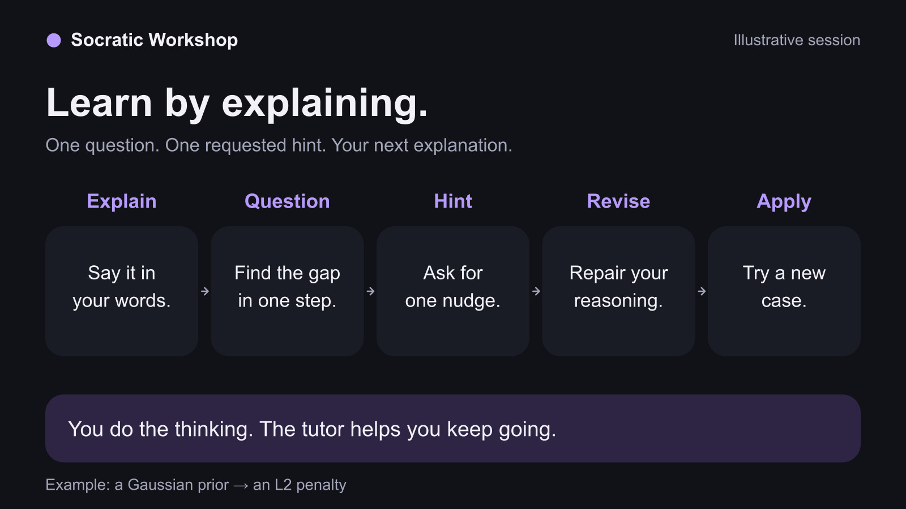
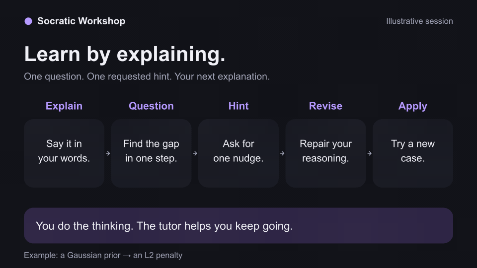
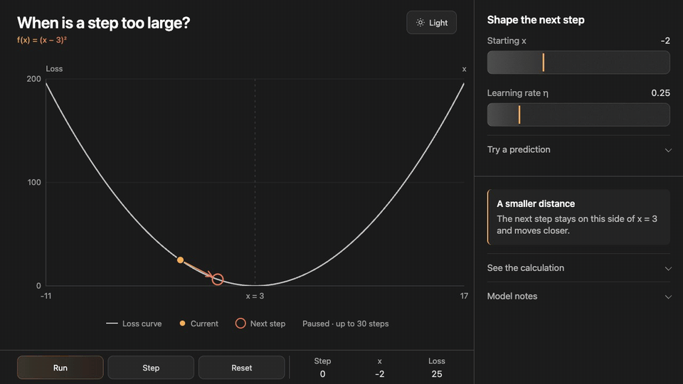
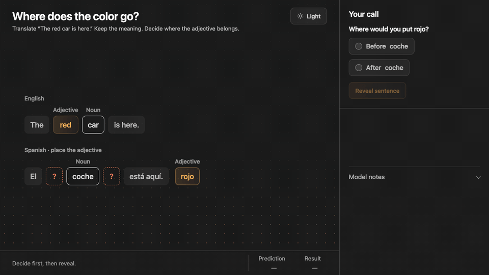
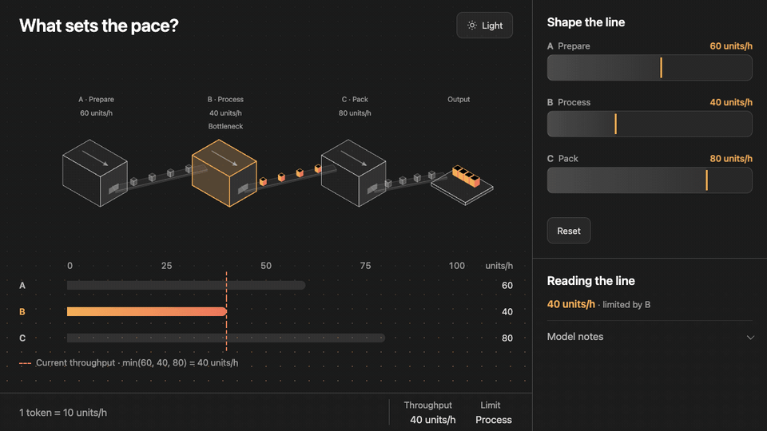

# Socratic Workshop

Learn an idea by explaining it to your AI tutor.

The tutor asks one question at a time and gives a small hint when you get stuck. You work through the gap and explain it again. Bring your own book, course, paper, or codebase.

When a picture helps, ask for a compact interactive HTML visualization. Explore it, make a prediction, and explain what changed.

Directly inspired by **Miles Cranmer's [How to Avoid AI Brain Rot](https://www.youtube.com/watch?v=uXC7OuCas2Q&t=1438)**, especially 23:58–34:33. The visual approach uses my Workbench adapter, inspired by **[Anatomy](https://github.com/wheresryan22/anatomy)**.

## Start a session

Install with the [skills CLI](https://github.com/vercel-labs/skills), then choose your agent:

```sh
npx skills add smashburger-dev/socratic-workshop
```

Add `-g` to install for your user instead of one project. While the repository is private, installation requires GitHub access.

| Agent | Start learning |
| --- | --- |
| [Claude Code](https://code.claude.com/docs/en/skills) | `/socratic-workshop Help me understand L2 regularization. Let me explain first.` |
| [Codex](https://developers.openai.com/codex/skills/) | `$socratic-workshop Help me understand L2 regularization. Let me explain first.` |

Claude Code uses `/skill-name`. Codex uses a `$skill-name` mention or its `/skills` picker. You can also ask your agent to use the skill in plain language.

## The learning loop



Explain what you understand. Work through one question or requested hint. Revise your explanation, then apply the idea to a small new case. Finish when your own reasoning establishes the goal you chose.



An illustrative conversation about a Gaussian prior and L2 regularization, rendered for this demo. It is not a recording of a real learner.

## Visual learning

### Gradient descent



[HTML file](examples/gradient-descent.html)

### Spanish word order



[HTML file](examples/spanish-word-order.html)

### Process bottlenecks



[HTML file](examples/bottleneck.html)

These GIFs are rendered previews of the example models.

Download an HTML file and open it in a browser. Each is standalone, with light/dark themes and no build step. GitHub's file view shows the source.

The same [visual templates](assets/visualization-shell.html) are available to the skill. A hint view reveals only the current hint; a full explanation can support direct exploration. Desktop examples are composed for a single visible frame.

You can ask for a hint, a visualization, a direct explanation, or a pause at any point. Study material stays outside the tutoring chat. In a codebase, the tutor offers a worktree, a branch, or read-only study before creating learning files. It creates no automated tests for those artifacts.

## Make it yours

Use this skill as a starting point. Adjust the visual style, change how hints work, or extend the learning loop to suit how you learn. Edit [SKILL.md](SKILL.md) and the [visual guidelines](references/workbench.md), or ask your agent to help.

## Credits

- [Miles Cranmer's talk](https://www.youtube.com/watch?v=uXC7OuCas2Q&t=1438), shared by MPhil in Data Intensive Science Cambridge, inspired the learning workflow.
- [Anatomy](https://github.com/wheresryan22/anatomy) inspired the visual approach, adapted from my Werkbankfiguren work in [Argmin](https://github.com/smashburger-dev/argmin).
- [Source notes](references/sources.md) separate the talk's ideas from this skill's additions.

## License

[MIT](LICENSE).
